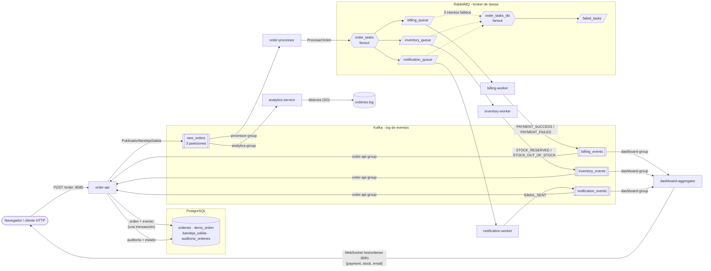

# Arquitectura

Rectángulos: microservicios. Cilindros: almacenamiento. Las flechas indican el sentido de los datos; la etiqueta
es el topic, la cola o el grupo de consumidores. Los nombres salen de `backend/common/.../nombres/`.

Puntos clave:

- `order-api` nunca publica directamente durante la petición: guarda el evento en `bandeja_salida` y
  `PublicadorBandejaSalida` lo envía cada segundo (patrón outbox).
- `analytics-service` y `dashboard-aggregator` releen sus topics desde el inicio al arrancar (`ConsumidorQueReleeTodo`).
- Cada worker solo conoce su cola y su topic (`TipoTarea`); el procesamiento común está en `EjecutorTarea`.
- Por qué Kafka para los eventos y RabbitMQ para los comandos: [kafka-vs-rabbitmq.md](../kafka-vs-rabbitmq.md).
