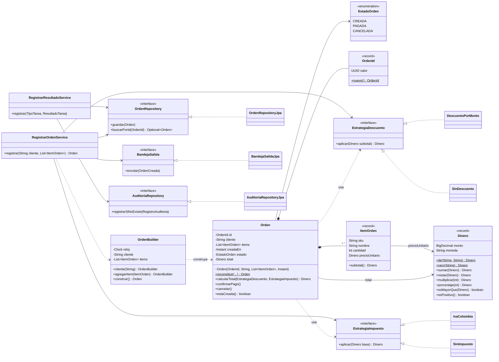

# Clases del dominio de order-api

Paquete `co.edu.proyecto.orden.dominio` (Java puro: lo comprueba `DominioPuroTest`), más los casos de uso de
`aplicacion/` y los adaptadores de `infraestructura/` que implementan los puertos.

| Elemento | Requisito | Detalle |
|---|---|---|
| `Orden` | Entidad rica | Sin setters; el constructor es de paquete (solo lo usa `OrdenBuilder`); `reconstituir` es para el mapper de JPA |
| `Dinero`, `OrdenId`, `ItemOrden` | Records con Fail-Fast | Validan en el constructor compacto y lanzan `OrdenInvalidaException` |
| `EstrategiaDescuento`, `EstrategiaImpuesto` | Strategy | `DescuentoPorMonto`: 10 % si el subtotal supera 100.000; `IvaColombia`: 19 %. Se eligen en `ConfiguracionDominio` |
| `OrdenBuilder` | Builder | Exige cliente y al menos un ítem; recibe un `Clock` para poder probar la fecha |
| `OrdenRepository` | Repository | Puerto en `dominio/puertos/`; `BandejaSalida` y `AuditoriaRepository` están en `aplicacion/puertos/` |
