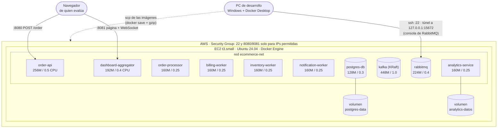

# Despliegue en AWS EC2 t3.small

Una sola instancia **t3.small** (2 vCPU, 2 GiB de RAM + 2 GiB de swap) con Ubuntu Server 24.04 y Docker Engine con
Compose v2. Las imágenes `ecommerce-hibrido-*:latest` se construyen en Windows y se copian con
[`exportar-imagenes.ps1`](../../ops/aws/exportar-imagenes.ps1); en la EC2 se arranca por tandas con
[`arrancar-aws.sh`](../../ops/aws/arrancar-aws.sh). Detalle completo: [despliegue-aws.md](../despliegue-aws.md).

| Puerto | Publicado en | Quién lo usa |
|---|---|---|
| 8080 | todas las interfaces (lo filtra el Security Group) | `POST /order` |
| 8081 | todas las interfaces (lo filtra el Security Group) | Tienda (`/`), panel de administración (`/admin.html`) y `/ws/ordenes` |
| 15672 | solo `127.0.0.1` de la EC2 | Consola de RabbitMQ, por túnel SSH |
| 5432, 9092, 5672 | no publicados | Solo dentro de `ecommerce-net` |

Suma de límites: 2048 MiB (techos individuales, no reserva). Consumo medido en local con los mismos límites:
ver el registro de [cumplimiento-enunciado.md](../cumplimiento-enunciado.md).
