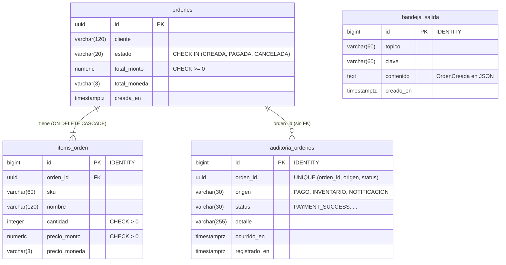

# Modelo entidad-relación

Tablas de [`schema.sql`](../../backend/order-api/src/main/resources/schema.sql). Solo `order-api` usa PostgreSQL.

| Tabla | Clase JPA | Notas |
|---|---|---|
| `ordenes` | `OrdenEntity` (`persistencia/orden/`) | `OrdenMapper` la traduce a `Orden` con `Orden.reconstituir(...)` |
| `items_orden` | `ItemOrdenEntity` | Se borran con su orden |
| `auditoria_ordenes` | `AuditoriaEntity` (`persistencia/auditoria/`) | Sin clave foránea: la relación con `ordenes` es lógica, por `orden_id`. `UNIQUE` + `ON CONFLICT DO NOTHING` la hace idempotente |
| `bandeja_salida` | `MensajePendienteEntity` (`bandejasalida/`) | Se escribe en la misma transacción que la orden y se borra cuando Kafka confirma |
