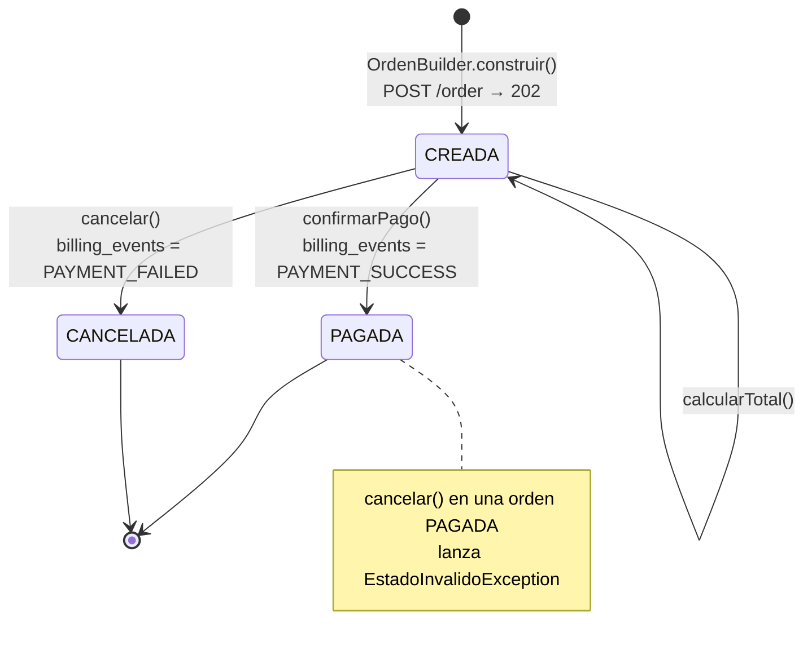
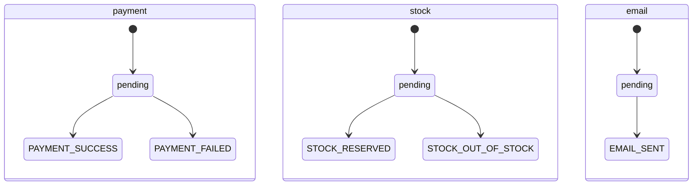

# Estados de la orden

## `Orden` en order-api (`EstadoOrden`)

Solo el resultado del **pago** cambia el estado (decisión D-08). Las transiciones las protege la propia entidad:
cualquier otra lanza `EstadoInvalidoException`.

Un resultado de pago repetido no hace nada: `RegistrarResultadoService` solo aplica el pago si la orden sigue `CREADA`.

## Cada tarea en el dashboard (`ProgresoOrden`)

El dashboard guarda `order_id → {payment, stock, email}`. Cada campo empieza en `"pending"` y cambia una sola vez,
cuando llega el resultado de su topic.

Los estados son el enum `EstadoTarea` (en `common`): cada uno sabe a qué `TipoTarea` pertenece y si es éxito;
un estado que llega por el topic de otra tarea se rechaza.
