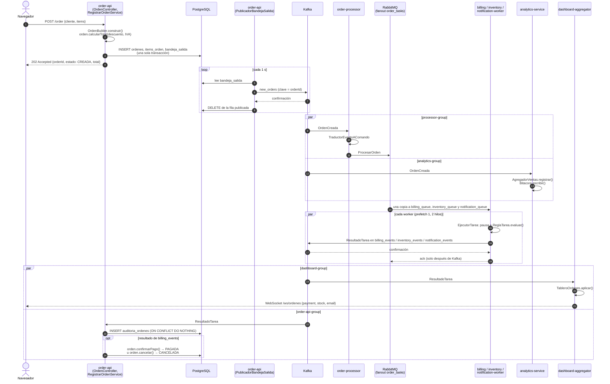

# Secuencia de una orden de punta a punta

Camino feliz de una orden válida. Los tres workers trabajan en paralelo (el bloque `par`); el orden en que llegan sus
resultados al dashboard puede variar.

Casos alternativos:

| Caso | Qué pasa |
|---|---|
| Datos inválidos (cantidad 0, precio 0, sin ítems) | `ManejadorErrores` responde **400** con el mensaje en español; no se guarda nada |
| Total > 1.000.000 (RN-11) | `ReglaPago` publica `PAYMENT_FAILED`; `order-api` cancela la orden |
| Un ítem con más de 10 unidades (RN-12) | `ReglaInventario` publica `STOCK_OUT_OF_STOCK`; queda en la auditoría y en el dashboard |
| Kafka caído al recibir la orden | La orden se acepta (202); el evento espera en `bandeja_salida` hasta que Kafka vuelve |
| Un worker falla 3 veces | El comando pasa a `order_tasks_dlx` → `failed_tasks` |
| Un resultado llega repetido | La auditoría lo ignora (`UNIQUE`) y la orden no cambia (solo se modifica si sigue `CREADA`) |
